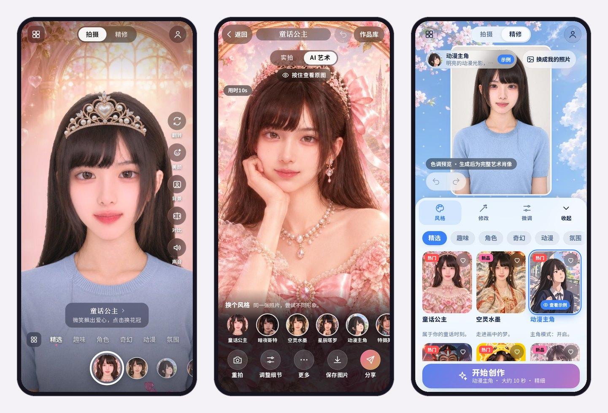
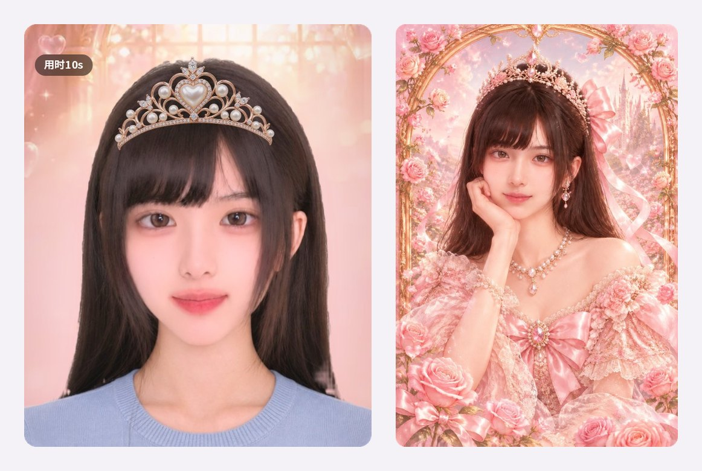
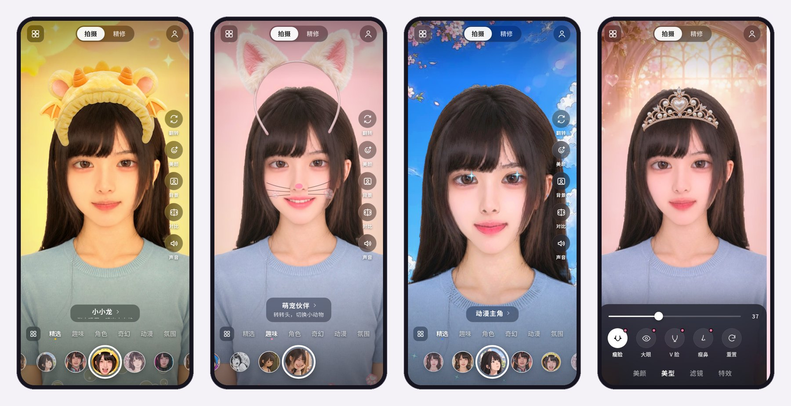
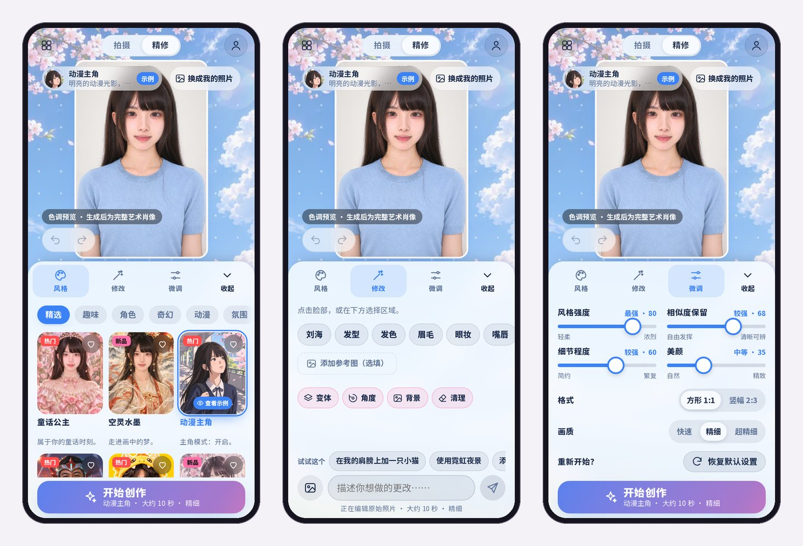

# HakiShow 项目介绍文档

> 一张自拍，遇见三十三种自己。

| 项目 | 内容 |
|---|---|
| 作品名称 | HakiShow（人工智能艺术头像生成器） |
| 团队 | Team01：组长、组员1、组员2 |
| 作品形态 | 响应式网页应用（可安装为 PWA）＋ FastAPI 工作室服务 |
| 目标用户 | 新加坡及亚太地区 18–30 岁、经常在社交平台发布内容的年轻人 |
| 文档日期 | 2026 年 11 月 22 日 |

## 1. 作品概述

HakiShow 是一款中文创意人像应用。打开相机就能用自然的美颜和 33 个互动特效包拍照；按下快门，实拍成片立刻出现，同时云端为你生成一张艺术肖像；之后还可以在精修工作室里换风格、改局部、用一句话描述修改。

整个产品分为三层：

- **基础美颜层**：磨皮、美白、红润、瘦脸、大眼、V 脸、瘦鼻与十种滤镜，叠加在任何特效之下。
- **实时特效层**：33 个特效包，每个包由美型、妆容、滤镜、背景、三维挂件、动作触发与音效组合而成。
- **云端创作层**：拍照后生成艺术肖像；支持局部编辑、一句话修改、变体与多角度。

## 2. 要解决的实际问题

我们调研了身边同学常用的相机与 AI 头像应用，归纳出三个痛点：

| 痛点 | 具体表现 | HakiShow 的做法 |
|---|---|---|
| 美颜不自然，特效跟不上 | 单点鼓包式瘦脸把背景一起扭曲；贴纸在转头和手抖时滞后、漂移 | 基于人脸网格的形变只作用于脸部；检测与绘制在同一帧完成，刚体运动与局部形状分别平滑 |
| AI 头像门槛高、等待长 | 先上传、再理解参数；生成时什么也看不到 | 相机里直接拍；实拍成片立即可见，艺术肖像约 7–14 秒后自动切换 |
| 想改一点就得整张重来 | 只想换发色或背景，却要重新生成整张图 | 精修工作室提供区域／画笔局部编辑与一句话修改，保留版本链，可撤销、重做 |

**典型使用场景**：更换社交头像、节日与生日海报、朋友间玩梗合拍、角色扮演、毕业纪念。

## 3. 产品方案

### 3.1 用户流程

1. **欢迎页**：全屏轮播真实作品，按住看原图、拖动对比，一眼看懂能做什么。
2. **实时相机**：左右滑动特效轮播，停下即自动应用；右侧工具栏提供翻转、美颜、背景、对比和声音。
3. **拍摄**：快门立即生成实拍成片，同时把原始照片送去生成艺术肖像。
4. **结果页**：在“实拍”与“AI 艺术”之间切换，分别保存或分享。
5. **精修工作室**：风格、修改、微调三个入口，继续创作。

### 3.2 一次快门，两张成片

本地实拍给出即时反馈，没有网络时依然可用；云端艺术肖像给出高质量作品。两者在同一个结果页里切换，既不让用户干等，也不牺牲最终质量。

## 4. 功能说明

| 模块 | 功能 |
|---|---|
| 欢迎页 | 故事式轮播：柔光扫过的原图→作品转换、缓慢推近、进度条、按住看原图、拖动对比；“开始拍摄”“试用示例”“跳过” |
| 实时相机 | 全屏取景、自动构图（人脸位于顶栏与底部面板之间的视觉中心）、前后摄像头切换、按住看原图、分屏对比 |
| 基础美颜 | 磨皮（半分辨率双边滤波＋高频回补）、美白、红润；瘦脸、大眼、V 脸、瘦鼻；十种滤镜（三维查找表）；特效强度 |
| 特效包 | 33 个，分为精选、趣味、角色、幻想、动漫、氛围、艺术七类；45 张透明贴纸作为三维姿态挂件；支持搜索、收藏和“互动”筛选 |
| 动作触发 | 张嘴、微笑、挑眉、转头、点击画面五种触发方式，配合火焰、光束、爱心、星光、冒汗、随机变形等特效与合成音效 |
| 背景 | 人像分割后虚化背景，或替换为与特效包匹配的风格场景 |
| 结果页 | 实拍与 AI 艺术切换、保存、分享卡片、进入精修 |
| 精修·风格 | 33 种风格，选择后画布立即显示本地色调预览 |
| 精修·修改 | 点选 12 个脸部区域（84 个选项）或画笔涂抹，或者直接用一句话描述修改；支持变体、换角度、换背景、清理 |
| 精修·微调 | 四个参数滑块、格式、画质、细节配饰（33 种风格共 264 个选项）与补充要求 |
| 版本与作品库 | 撤销／重做、草稿恢复、结果版本链、收藏、作品库 |
| 账户与同步 | 访客模式、注册登录、账户内素材与记录的增量同步 |

## 5. 设计思路

- **内容优先**：取景全屏，工具贴边且半透明，让人像站到前面。
- **统一材质**：深色毛玻璃与 0.5 像素高光描边；白色主按钮，不使用渐变文字和描边按钮。
- **中文排版**：随附思源黑体／思源宋体子集，并覆盖字体度量（ascent 88%、descent 12%），使按钮中的中文字形在垂直方向精确居中，实测偏差在 ±0.5 像素以内。
- **有物理感的动效**：拾取器式轮播缩放、停下即应用；欢迎页柔光扫过；挂件弹性出现；配合触感与音效反馈。
- **为第一次使用的人做减法**：精修工作室打开即载入示例照片，不再要求先上传；入口从“风格、调整、细节、区域、对话”五个精简为“风格、修改、微调”三个。

## 6. 技术开发方案

### 6.1 总体架构

| 层 | 技术 | 职责 |
|---|---|---|
| 浏览器（PWA） | 原生 ES 模块、esbuild 打包、类型检查（tsc checkJs） | 界面、实时渲染管线、IndexedDB 本地数据、服务工作线程缓存 |
| 实时视觉 | MediaPipe 人脸关键点（478 点＋表情系数）与人像分割，模型随项目分发 | 人脸跟踪、表情识别、背景分割 |
| 渲染 | WebGL 多通道着色器＋Canvas 2D 叠加 | 形变、磨皮、妆容、背景、查找表滤镜、风格通道；三维挂件与特效 |
| 工作室服务 | Python FastAPI（likeness） | 账户、素材存储、任务队列、进度事件、取消与重试、引擎切换（模拟器／OpenAI／Codex） |
| 模型服务 | GPT Image 2.6（生成与蒙版编辑）、GPT-5.4 mini（中文回复、建议与风格创意） | 艺术肖像、局部编辑、对话修改 |

接口方面，浏览器通过 /api/assets 上传素材、通过 /api/turns 提交创作任务，服务器用服务器推送事件返回进度。没有工作室服务时，静态展示模式用随附示例与本地预览完成同样的流程。

### 6.2 实时渲染管线

每一帧依次执行五步：

1. **检测**：在同一帧内获取 478 个关键点与表情系数；开启背景功能时进行人像分割。
2. **平滑**：在人脸坐标系中把刚体运动与局部形状分开，分别使用 One Euro 滤波；短暂丢失人脸时保持 280 毫秒。
3. **形变**：三角网格加脸外过渡环，以瞳距为单位计算位移场，侧脸时自动减弱。
4. **合成**：双边滤波磨皮、美白红润、唇色腮红、背景虚化或替换、三维查找表滤镜、风格通道（辉光采用亮度平滑阈值与滤色混合，避免高光过曝）。
5. **叠加**：用投影得到的人脸坐标轴构造弱透视变换，佩戴三维挂件；动作状态机采用上升沿触发、迟滞阈值与冷却时间，避免误触和连发。

关键决策：**同帧检测**替代异步检测，使贴纸与人脸严格对齐；**网格形变**替代单点鼓包，背景和发丝不再被拉扯；**本地实拍＋云端艺术**的双成片，兼顾即时反馈与作品质量。

### 6.3 数据、离线与安全

- 作品、草稿、偏好和撤销历史保存在 IndexedDB；编辑中的草稿同时写入 localStorage，刷新也不会丢失。
- 服务工作线程缓存模型、字体与图像素材，弱网环境下也能快速打开。
- 模型服务密钥只保存在服务器本地、已被版本控制忽略的 .env.local 中，不进入前端代码和代码仓库。

## 7. 团队组成与分工

| 成员 | 角色 | 主要负责 |
|---|---|---|
| 组长 | 产品与集成负责人 | 需求分析与产品方案、主流程集成、生成编排与版本流程、验收测试、答辩统筹、介绍文档与分工文档 |
| 组员1 | 体验与视觉负责人 | 欢迎页、实时相机、结果页与精修界面，风格主题、贴纸素材与动效，中文排版，答辩 PPT 设计与演示视频 |
| 组员2 | 工作室与成像负责人 | FastAPI 工作室服务与模型连接，人脸跟踪、网格形变与 WebGL 渲染管线，人像分割、特效包与动作触发，服务端测试 |

详细分工、成果对应关系与 10 分制贡献评价见《HakiShow 成员任务分工文档》。

## 8. 最终成果

| 成果 | 结果 |
|---|---|
| 浏览器端到端测试 | 18 / 18 通过（欢迎页、实时相机、美颜面板、搜索、拍摄成片、结果切换、精修三入口、区域与画笔、对话、重新加载与注册） |
| 服务端测试 | 75 / 75 通过（账户隔离、任务队列、取消与重试、引擎、同步） |
| 类型检查与构建 | npm run check 与 npm run build 无错误 |
| 视口覆盖 | 360×640、390×844、430×932、1280×800 |
| 中文排版 | 核心按钮文字墨迹居中偏差 ±0.5 像素以内 |
| 真实服务 | 从实时相机按下快门到 AI 艺术肖像完成约 7–14 秒，已用动漫主角、小小龙、复古电影、萌宠伙伴、星辰塔罗、童话公主等风格验证 |
| 动作触发 | 用带表情变化的测试视频验证：张嘴喷火、微笑飘爱心、挑眉冒汗、点击随机变形 |

## 9. 已知限制与后续改进

**已知限制**

- 实时相机的性能与观感目前在模拟相机（软件渲染）下验证，实体手机上的帧率、发热与手持抖动稳定性仍需复核。
- 实时相机的艺术效果由本地着色器、网格形变、分割与贴纸完成；用图像模型连续变换每一帧视频尚未实现。
- 真实服务商下的蒙版编辑、变体与多角度仍需更多样本检查。

**后续改进**

1. **实体设备复核**：在中端安卓与 iPhone 上测量帧率与发热，按设备自动选择分辨率与分割开关。
2. **三维模型与遮挡**：引入轻量三维挂件，让头部遮挡挂件后半部分。
3. **实时风格化**：评估浏览器内的小型风格迁移网络，作为“实拍”与“AI 艺术”之间的中间层。
4. **分享与共创**：一键生成分享卡片与短视频，支持好友合拍与特效共创。

## 10. 开发与内容说明

- 开发过程中使用了 AI 编程助手辅助代码编写、测试与文档整理；产品中的艺术肖像由 OpenAI GPT Image 模型生成。
- 演示视频与截图中的人物，是素材库中的虚拟人物 mei（33 种风格肖像都由她变化而来）。相机画面以她的原图作为模拟输入；微笑、张嘴和眨眼帧只在原图上局部修改嘴部或眼部，仅用于功能演示。
- 运行方式见仓库根目录 README.md 与 docs/SETUP.md。
